# 유랑 (Yurang)

> 한국풍 사이버펑크 아포칼립스 — 무너진 서울 변두리에서 마을을 다시 세우고, 밤마다 몰려오는 잡귀를 막고, 한국 설화 속 귀신들의 이야기를 파헤친다.

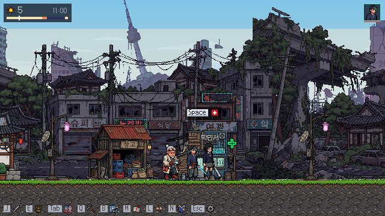

**[⬇ 다운로드 (Releases)](https://github.com/kimtuna/withu-release/releases/latest)** — macOS (Apple Silicon · Intel) / Windows 64bit

> 개발 중인 버전입니다 (v0.4). 소스 코드는 비공개이고, 이 저장소에는 실행 파일과 소개만 있습니다.

---

## 어떤 게임인가

| | |
|---|---|
| **지상** | 횡스크롤로 마을을 걸어 다니며 폐차를 뜯어 자원을 모으고, 동료에게 일을 맡겨 무너진 건물을 다시 짓는다. 밤이 되면 잡귀가 몰려오고, 마을을 지켜야 한다. |
| **던전** | 지하철 둥지로 내려가 턴제 전투. 칸(1~4) 위치에 따라 쓸 수 있는 기술이 다르고, 스트레스가 쌓이면 동료가 무너진다. |
| **스토리** | 한국 설화(범과 창귀, 산군)를 바탕으로 한 이야기. 대화·선택(낮/밤, 싸울지 말지)에 따라 갈래가 나뉜다. |
| **방탈출** | 스토리 속 기숙사는 걸어 다니지 않고 마우스로 누르는 방. 열쇠, 번호 자물쇠, 손전등으로 비추기, 찢어진 쪽지 맞추기, 문 두드리는 신호, CCTV 녹화 검색으로 사라진 아이를 찾는다. |
| **제작** | 식당 미니게임으로 음식을 만들고, 대장간 미니게임으로 동료의 무기·옷을 +5까지 강화한다 (단계마다 빛·잔상·오라). |
| **동료** | 주점에서 손님을 영입하고, 진료소에서 치료하고, 칩을 꽂아 직업을 바꾼다. 마을 동료는 지상에서도 기술을 스스로 쓴다. |
| **네버엔드** | 1편 뒤 열리는 레이드 — 버려진 놀이공원·동물원 지도에서 구역을 골라 들어가 흑호와 창귀들을 쓰러뜨린다. 이벤트 물건, 직업 칩, 맹수 길들이기, 숨은 사육사 길. |
| **멀티** | 최대 4명 같이 하기 (호스트 + 참가). |

## v0.4 — 네버엔드

| | |
|---|---|
| 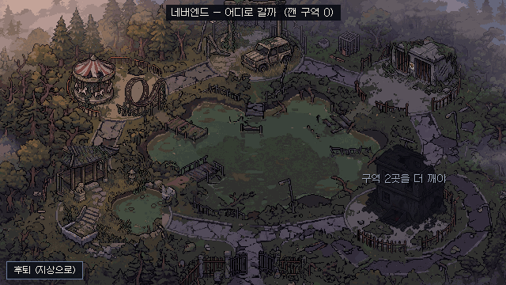 | 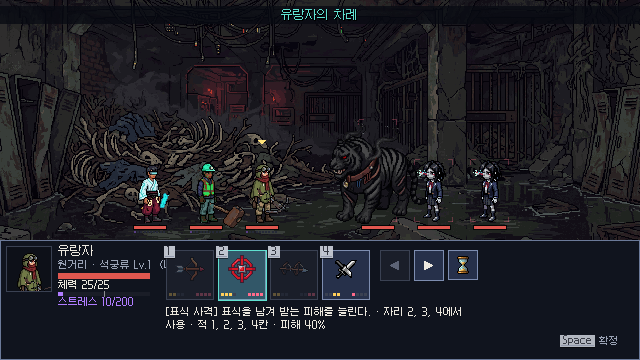 |
| 네버엔드 지도 — 구역을 골라 들어간다 | 흑호의 굴 |
| 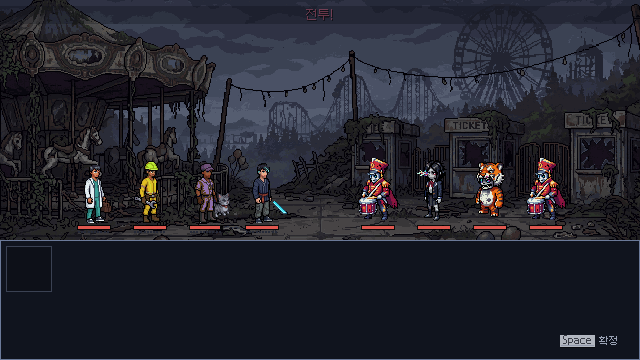 | 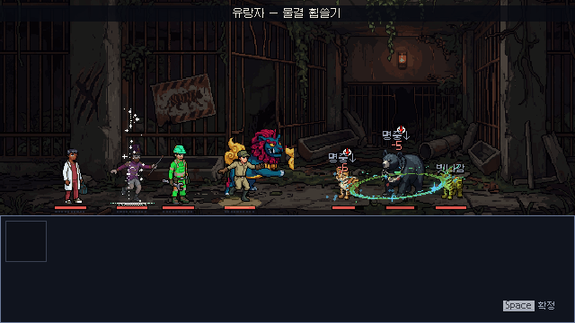 |
| 놀이공원 창귀들 (탈인형·풍선 장수·악단…) | 해태를 길들인 사육사 — 물결 휩쓸기 |
| 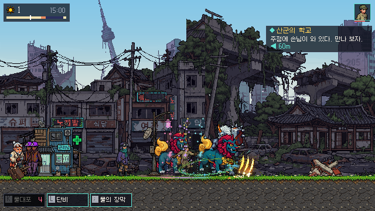 | 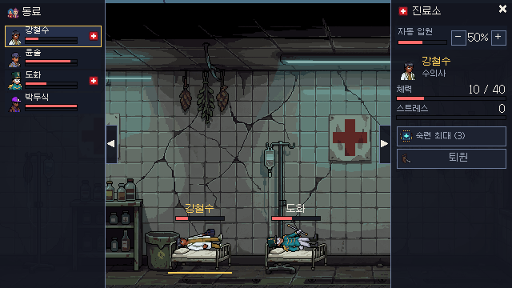 |
| 지상 기술 J·K·L·; | 진료소 칩 꽂기 — 직업 바꾸기 |

- **칩 직업 5개**: 맹수 사육사(숨은 직업) · 수의사 · 사파리 버스 기사 · 놀이기구 정비공 · 퍼레이드 연기자. 같은 칩을 또 꽂으면 숙련(최대 3).
- **사육사의 동물**: 고양이 → 삵 → 반달가슴곰 → 해태. 동물마다 기술 묶음이 다르고(보조 / 출혈·치명 / 탱커 / 물·정의), 사육사가 없으면 맹수는 적으로 덤빈다.
- **새 창귀 5종**과 흑호 — 창귀를 부르고, 먹고, 뒷줄을 덮친다.

## 스크린샷

| | |
|---|---|
| 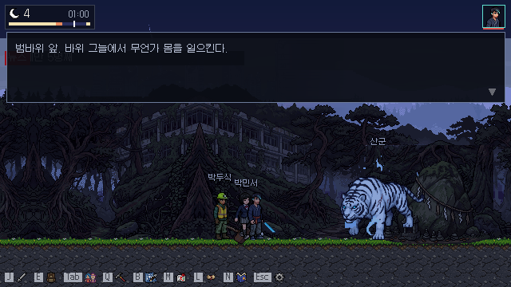 | 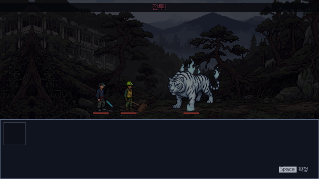 |
| 스토리 「산군의 학교」 — 범바위 | 턴제 전투 |
| 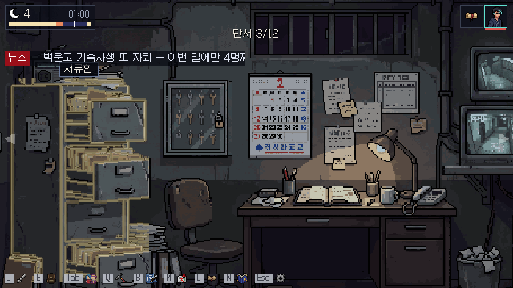 | 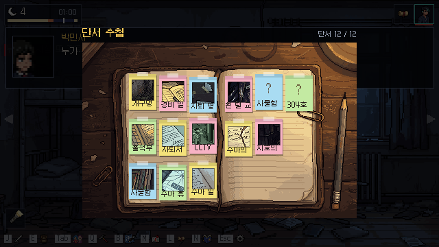 |
| 마우스로 조사하는 방 | 단서 수첩 (포스트잇) |
| 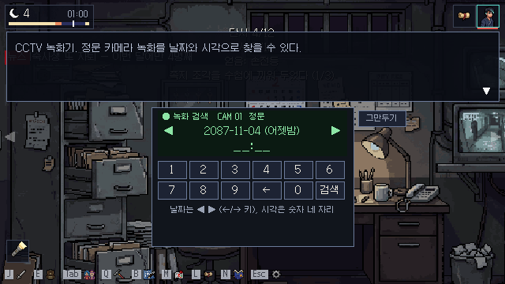 | 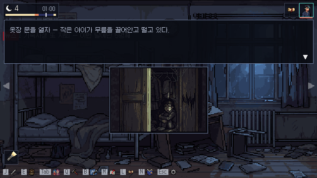 |
| CCTV 녹화 검색 퍼즐 | 조사하면 가까이 본 그림 |
| 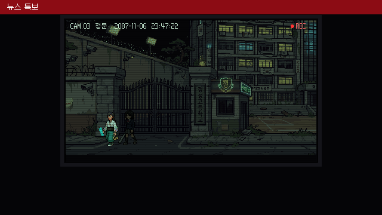 | 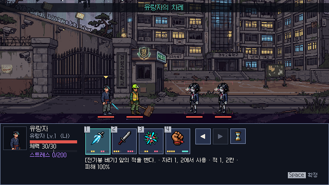 |
| 뉴스 특보 연출 | 밤의 학교 |
| 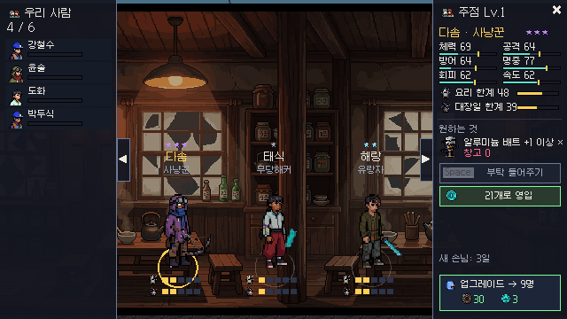 | 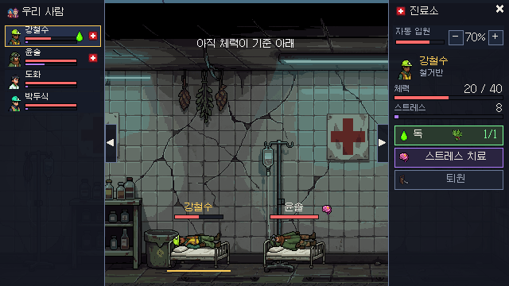 |
| 주점 — 동료 영입 | 진료소 |
| 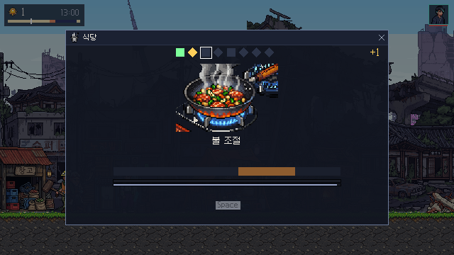 | 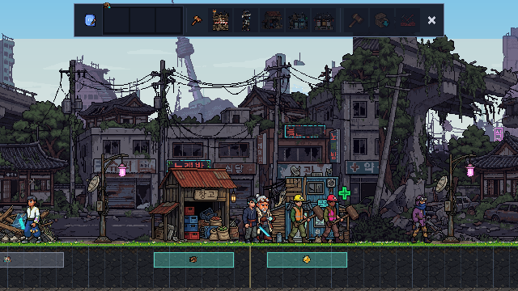 |
| 제작 미니게임 | 건축 모드 |
| 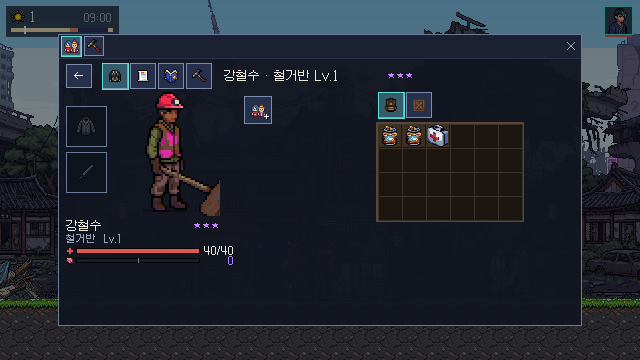 | 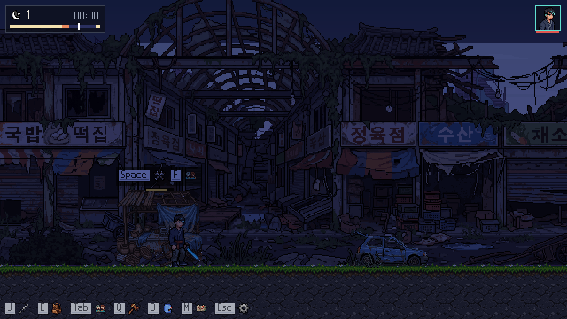 |
| 동료 장비 | 밤의 시장 |

## 조작

| 키 | |
|---|---|
| A / D | 걷기 |
| Space | 조사 · 상호작용 |
| T | 사람과 대화 · 팀 초대 |
| J | 공격 |
| K / L / ; | 지상 기술 (던전에선 1~4 또는 J·K·L·;) |
| W | 갈림길로 이동 |
| E | 가방 |
| Tab / Q | 동료 · 일 맡기기 |
| B | 건축 |
| M | 지도 |
| O | 퀘스트 |
| N | 단서 수첩 |
| Backspace / 오른쪽 클릭 | 대화 뒤로 |
| Esc | 메뉴 |

## 설치 · 실행

**macOS**
1. `Yurang-mac-…zip` 을 받아 압축을 푼다 → `유랑.app`
2. 처음 한 번은 **우클릭 → 열기** (애플 개발자 서명이 없어 "확인되지 않은 개발자" 경고가 뜬다)
   - 그래도 막히면: 시스템 설정 → 개인정보 보호 및 보안 → "그래도 열기"

**Windows**
1. `Yurang-windows-…zip` 을 받아 압축을 푼다 → `Yurang.exe`
2. SmartScreen 경고가 뜨면 **추가 정보 → 실행**

## 만든 방식

- **엔진**: Godot 4.7 (GDScript)
- **멀티 구조**: 호스트가 모든 상태를 계산하고 참가자는 스냅샷을 받아 그리기만 한다. 혼자 하기도 같은 길(요청 → 호스트 처리)을 타서, 멀티와 싱글이 한 코드로 돈다.
- **그림**: PixelLab 으로 캐릭터·배경·아이콘을 뽑고, Python(Pillow) 빌드 도구로 프레임을 맞춘다.
  - 옷 갈아입기: 기본 몸 하나에 옷·무기를 같은 프레임으로 입혀 뽑은 뒤 "입힌 것 − 맨몸" 차이로 레이어를 분리 → 장비를 바꾸면 레이어만 갈아 끼운다.
  - 조사할 물건의 테두리 빛: 배경 그림의 외곽선 픽셀을 뽑아 만든다.
- **스토리 시스템**: 대본은 데이터(장면·대사·선택·조건)로 쓰고, 진행 로직(투표, 이어하기 자리, 번호 자물쇠·노크·녹화 검색 퍼즐, 손님 동료가 함께 싸우는 스토리 전투)은 엔진 쪽에서 처리.
- **자동 테스트**: 창 없이 게임을 돌려 확인하는 시나리오 40여 개 (스토리 네 갈래를 처음부터 끝까지, 레이드, 칩 직업 기술 70여 가지, 제작, 저장/불러오기 등) + 2·3·4인 멀티 QA. 팀 구성별로 수백 판을 자동으로 싸워 보는 밸런스 시험. 애니메이션은 프레임 단위로 잘라 확인.

---

© kimtuna. All rights reserved. 실행 파일의 재배포를 허용하지 않습니다.
